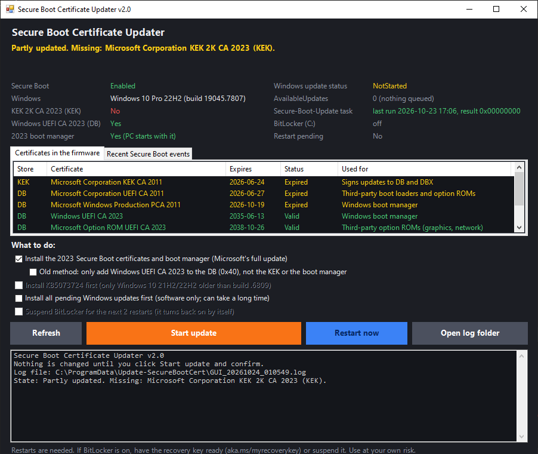
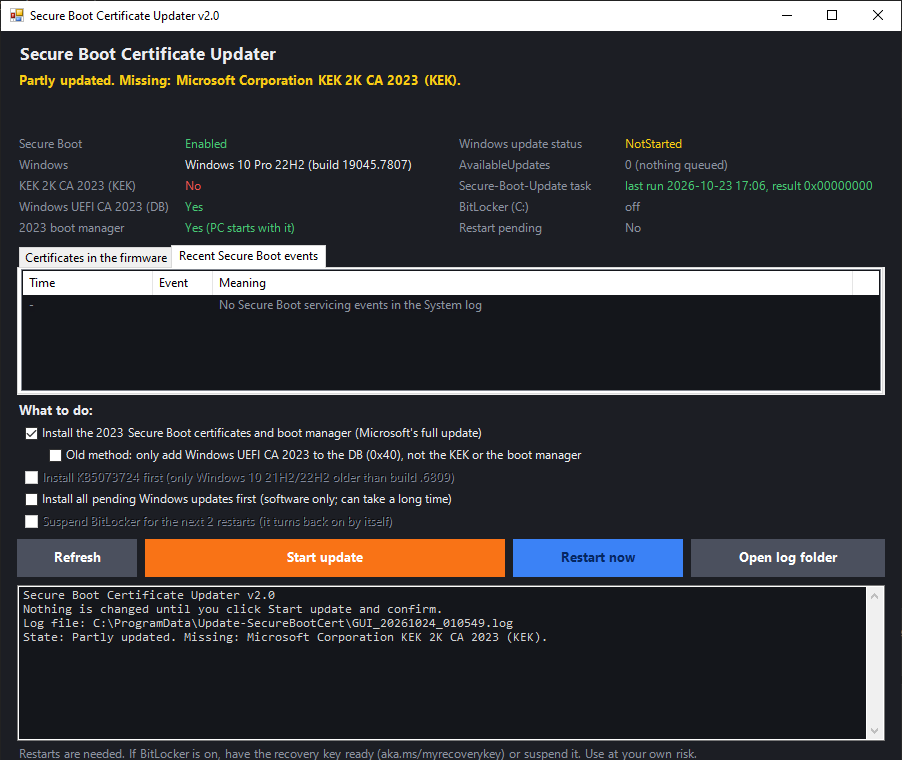
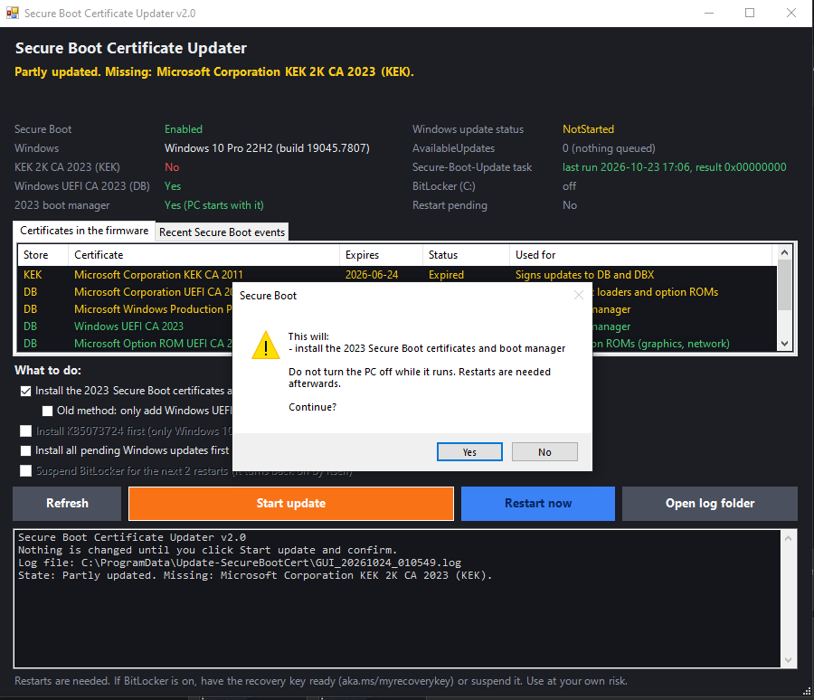

# Windows Secure Boot 憑證更新工具

> [!IMPORTANT]
> Microsoft 2011 年版的 Secure Boot 憑證已於 2026 年 6 月至 10 月間陸續到期。沒有 2023 年版憑證的電腦**仍然可以正常開機，也仍會收到一般的 Windows 更新**，但將不再收到開機流程的安全性更新（開機管理員、Secure Boot DB/DBX 更新、撤銷清單）。本工具會檢查您的電腦，並在需要時請 Windows 安裝 2023 年版憑證與以 2023 憑證簽署的開機管理員。
>
> 📦 **[下載 Update-SecureBootCert.zip](https://github.com/j0p3s/Update-SecureBootCert/releases/latest/download/Update-SecureBootCert.zip)**

[English](./README.md)

 

## 📑 目錄

- [快速開始](#快速開始)
- [螢幕截圖](#螢幕截圖)
- [2026 年憑證到期代表什麼](#2026-年憑證到期代表什麼)
- [本工具做什麼](#本工具做什麼)
- [支援的系統](#支援的系統)
- [命令列](#命令列)
- [如何解讀狀態](#如何解讀狀態)
- [沒有 ESU 的 Windows 10](#沒有-esu-的-windows-10)
- [疑難排解](#疑難排解)
- [如果電腦無法開機](#如果電腦無法開機)
- [Legacy BIOS (CSM) 使用者](#legacy-bios-csm-使用者)
- [企業部署](#企業部署)
- [手動檢查](#手動檢查)
- [參考資料](#參考資料)
- [致謝](#致謝)
- [更新紀錄](#更新紀錄)

---

## 快速開始

1. 下載 zip 並解壓縮。如果 Windows 封鎖檔案，請在解壓縮前對 zip 按右鍵 →**內容** → 勾選**解除封鎖**。
2. 開啟以下其中一個（都只會要求一次系統管理員權限）：
   - **`Update-SecureBootCert-GUI.cmd`**：視窗介面，顯示狀態與選項。
   - **`RunMe.bat`**：在主控台視窗中執行相同步驟。
3. 查看上方的狀態。如果顯示尚未更新，請開始更新。在您確認之前不會做任何變更。
4. 依提示**重新開機**，然後**再次開啟本工具**：它會啟動下一個步驟並確認結果。可能還會要求再重新開機一次。

> [!TIP]
> 如果電腦使用 **BitLocker**，請先準備好 48 位數的修復金鑰（[aka.ms/myrecoverykey](https://aka.ms/myrecoverykey)），或在工具中選擇**暫停 BitLocker 2 次重新開機**。之後 BitLocker 會自動恢復。

記錄檔儲存在 `%ProgramData%\Update-SecureBootCert`。

---

## 螢幕截圖

在部分更新的 Windows 10 電腦上執行 GUI（`Update-SecureBootCert-GUI.cmd`）。上方顯示結果，其下是電腦狀態與韌體中找到的憑證。



**Recent Secure Boot events** 分頁列出系統記錄中的 Secure Boot 訊息，並附上說明。



在您按下 **Start update** 並確認之前，不會做任何變更。



---

## 2026 年憑證到期代表什麼

| 舊憑證 | 到期日 | 取代為 | 儲存位置 | 用途 |
|---|---|---|---|---|
| Microsoft Corporation KEK CA 2011 | 2026-06-24 | Microsoft Corporation KEK 2K CA 2023（有效至 2038） | KEK | 簽署 DB 與 DBX 的更新 |
| Microsoft Corporation UEFI CA 2011 | 2026-06-27 | Microsoft UEFI CA 2023（至 2038） | DB | 第三方開機載入器（Linux shim、工具） |
| Microsoft Corporation UEFI CA 2011 | 2026-06-27 | Microsoft Option ROM UEFI CA 2023（至 2038） | DB | 第三方 Option ROM（顯示卡、網路卡） |
| Microsoft Windows Production PCA 2011 | 2026-10-19 | Windows UEFI CA 2023（至 2035） | DB | Windows 開機管理員 |

**沒有 2023 年版憑證會怎樣：**
- ✅ 電腦仍可開機。UEFI 韌體在開機時不會檢查憑證的到期日。
- ✅ 一般的 Windows 更新仍會繼續安裝。
- ❌ 不再收到開機流程的安全性更新：新的開機管理員、DB/DBX 更新，以及新發現的開機層級漏洞修正。
- ❌ 日後只以 2023 憑證簽署的新開機媒體與第三方開機載入器，在 Secure Boot 開啟時將無法啟動。

過期的 2011 憑證會與 2023 憑證一起保留在韌體中，讓舊的開機媒體仍可使用。這是正常的。

---

## 本工具做什麼

### 1. 讀取狀態（不做任何變更）

| 項目 | 來源 |
|---|---|
| Secure Boot 開啟/關閉 | `Confirm-SecureBootUEFI` |
| KEK 與 DB 中的憑證及其實際到期日 | 韌體變數，以 EFI 簽章清單解析 |
| Windows 自身的更新狀態 | `HKLM\SYSTEM\CurrentControlSet\Control\SecureBoot\Servicing`（`UEFICA2023Status`、`UEFICA2023Error`、`WindowsUEFICA2023Capable`） |
| 已排入的更新 | `AvailableUpdates` |
| Secure-Boot-Update 排程工作 | 上次執行時間與結果 |
| 系統磁碟的 BitLocker | 開啟/關閉、修復金鑰保護裝置 |
| 待重新開機 | Windows 服務旗標 |
| 最近的 Secure Boot 事件 | 系統記錄檔，來源 TPM-WMI，並附說明 |

### 2. 更新（僅在您確認後）

| 步驟 | 條件 | 預設 |
|---|---|---|
| 從 Microsoft Update Catalog 安裝 **KB5073724** | 僅限 Windows 10 21H2/22H2，且組建早於 1904x.6809 | 開啟 |
| 安裝所有待安裝的 Windows 軟體更新 | 選用（不含驅動程式與已隱藏的更新） | 關閉 |
| 暫停 BitLocker 2 次重新開機 | 僅在 BitLocker 開啟時 | 關閉（會詢問） |
| 設定 `AvailableUpdates = 0x5944` 並啟動 Secure-Boot-Update 排程工作 | Microsoft 的完整更新：2023 KEK、2023 DB 憑證與以 2023 憑證簽署的開機管理員 | 開啟 |

如果 Windows **已經排入**更新（例如 `0x4100`），本工具不會覆寫，只會啟動排程工作。
舊的 v1.x 方法（`0x40`，只將 Windows UEFI CA 2023 加入 DB）仍可作為選項使用。

### 3. 顯示結果

工具會重新讀取所有狀態，說明剩下的步驟並詢問是否重新開機。一般流程為：

1. 排程工作執行 → `AvailableUpdates` 變成 `0x4100`（憑證已套用，開機管理員待安裝）。
2. **重新開機**，再執行本工具 → 排程工作完成 → `0x4000`，狀態 `Updated`。
3. 可能需要再重新開機一次，直到 Windows 從以 2023 憑證簽署的開機管理員啟動（`WindowsUEFICA2023Capable = 2`）。

如果您沒有再次執行，Windows 也會在大約 12 小時內自行執行該排程工作。

---

## 支援的系統

- ✅ Windows 11（所有版本）
- ✅ Windows 10 22H2 / 21H2，包含 Enterprise LTSC 2021 與 IoT Enterprise LTSC 2021
- ✅ Windows Server 2016 / 2019 / 2022 / 2025
- ⚠️ 需為啟用 Secure Boot 的 UEFI。Legacy BIOS (CSM) 模式下韌體中沒有需要更新的項目。
- ⚠️ 必須有 **Secure-Boot-Update** 排程工作（屬於目前 Windows 更新中的 Secure Boot 服務）。如果沒有，請先安裝最新的累積更新。
- ⚠️ 需要系統管理員權限。只有選用的 KB5073724 與 Windows Update 步驟需要網路。

---

## 命令列

```powershell
.\Update-SecureBootCert.ps1 [-CheckOnly] [-Unattended] [-InstallWindowsUpdates] [-SkipKB]
                            [-DbOnly] [-SuspendBitLocker] [-Restart] [-NoPause] [-LogPath <檔案>]
```

| 參數 | 作用 |
|---|---|
| `-CheckOnly` | 只顯示狀態，不做任何變更 |
| `-Unattended` | 不詢問；使用預設值加上您指定的參數 |
| `-InstallWindowsUpdates` | 同時安裝所有待安裝的 Windows 軟體更新 |
| `-SkipKB` | 不在較舊的 Windows 10 上安裝 KB5073724 |
| `-DbOnly` | 舊方法：只將 Windows UEFI CA 2023 加入 DB（`0x40`） |
| `-SuspendBitLocker` | 暫停 BitLocker 接下來 2 次重新開機 |
| `-Restart` | 需要時自動重新開機（30 秒後） |
| `-NoPause` | 結束時不等待按 Enter |
| `-LogPath` | 記錄檔的位置 |

`RunMe.bat` 會將參數傳遞給腳本，例如 `RunMe.bat -CheckOnly`。

**結束代碼**

| 代碼 | 意義 |
|---|---|
| 0 | 已是最新，或無需處理（包含 Legacy BIOS） |
| 1 | 錯誤 |
| 2 | 需要更新（`-CheckOnly`）或尚未完成 |
| 3 | 已取消 |
| 3010 | 需要重新開機；之後請再執行本工具 |

**範例**

```powershell
# 僅報告
.\Update-SecureBootCert.ps1 -CheckOnly

# 靜默執行（部署工具用），並自動重新開機
powershell.exe -NoProfile -ExecutionPolicy Bypass -File .\Update-SecureBootCert.ps1 -Unattended -SuspendBitLocker -Restart
```

---

## 如何解讀狀態

**`AvailableUpdates`**（`HKLM\SYSTEM\CurrentControlSet\Control\SecureBoot`）

| 值 | 意義 |
|---|---|
| 未設定 / `0` | 沒有排入的更新 |
| `0x5944` | 已排入完整更新（本工具設定的值） |
| `0x4100` | 憑證已套用；重新開機後，排程工作會安裝開機管理員 |
| `0x4000` | 已完成 |
| `0x40` | 舊方法：Windows UEFI CA 2023 已排入 DB |

**`UEFICA2023Status`**：`NotStarted`、`InProgress` 或 `Updated`。**`UEFICA2023Error`**：沒有錯誤時為 0。
**`WindowsUEFICA2023Capable`**：0 = DB 中沒有 2023 CA，1 = 已在 DB 中，2 = 已在 DB 中且電腦從以 2023 憑證簽署的開機管理員啟動。

**事件**（系統記錄檔，來源 TPM-WMI）

| 事件 | 意義 |
|---|---|
| 1808 | 完成：電腦已有 2023 憑證與開機管理員 |
| 1799 | 已安裝以 Windows UEFI CA 2023 簽署的開機管理員 |
| 1036 / 1043 / 1044 / 1045 | DB 已更新 / KEK 已更新 / 已加入 Option ROM CA / 已加入 Microsoft UEFI CA 2023 |
| 1800 | 需要重新開機才能繼續更新 |
| 1801 | 2023 憑證/開機管理員尚未完全套用 |
| 1032 | 未套用：BitLocker 會要求輸入修復金鑰 |
| 1795 / 1796 | 韌體錯誤或非預期錯誤；Windows 會在下次重新開機時重試 |
| 1802 | 因此裝置已知的韌體問題而被 Microsoft 封鎖 |
| 1803 | 無法更新 KEK：電腦製造商沒有以此電腦平台金鑰 (PK) 簽署的 KEK |

---

## 沒有 ESU 的 Windows 10

- KB5073724（2026 年 1 月）及之後的 Windows 10 累積更新屬於 ESU 更新。沒有 ESU 授權時可能無法安裝，或在重新開機後被 Windows 移除。如果電腦已是組建 .6809 或更新，本工具會略過此步驟。
- 憑證步驟**不**依賴 KB5073724。它使用 Windows 自身的 Secure-Boot-Update 排程工作，已更新的 Windows 10 組建都有（Microsoft 自 2024 年起已在 KB5036210 中說明只更新 DB 的方法）。
- 較舊的 Windows 10 組建能完成多少完整更新，取決於最後安裝的更新。本工具會明確顯示套用了哪些項目（KEK、DB、開機管理員）。如果無法完成 KEK 或開機管理員步驟，仍可使用舊方法（`-DbOnly`）將 Windows UEFI CA 2023 加入 DB。

---

## 疑難排解

| 看到的情況 | 處理方式 |
|---|---|
| 事件 **1803**（無法更新 KEK） | 韌體中沒有此電腦型號的 Microsoft 簽署 KEK 更新。請安裝電腦製造商最新的 BIOS/UEFI 更新。DB 憑證仍可加入。 |
| 事件 **1802**（已知韌體問題而被封鎖） | 安裝最新的 BIOS/UEFI 更新後，再執行本工具。 |
| 事件 **1795 / 1796** | 韌體拒絕變更。請更新 BIOS/UEFI；Windows 會在每次重新開機時重試。 |
| 事件 **1032** | BitLocker 會進入修復模式。請暫停 BitLocker 2 次重新開機後再執行更新。 |
| 「Secure-Boot-Update task NOT FOUND」 | 請安裝此 Windows 最新的累積更新。 |
| 狀態一直是 `InProgress` | 重新開機後再執行本工具（它會啟動排程工作）。請在工具中查看 `UEFICA2023Error` 與事件。 |
| 虛擬機器 | 必須開啟 Secure Boot，且虛擬化平台必須允許更新 KEK/DB。請參考您的虛擬化平台說明。 |

---

## 如果電腦無法開機

單純的憑證到期不會讓電腦無法開機。如果在變更韌體或開機設定後，電腦在 Secure Boot 開啟時無法啟動：

**A. BitLocker 要求修復金鑰**：輸入 [aka.ms/myrecoverykey](https://aka.ms/myrecoverykey) 中的 48 位數金鑰，之後 Windows 即可正常啟動。

**B. 暫時關閉 Secure Boot**
1. 進入 BIOS/UEFI 設定（開機時通常按 `Del`、`F2` 或 `F10`）。
2. 將 **Secure Boot** 設為 **Disabled**，儲存並重新開機。
3. 在 Windows 中執行本工具並等它完成。
4. 在 BIOS/UEFI 設定中重新開啟 **Secure Boot**。

**C. 在韌體中加入憑證（進階）**
1. 在另一台電腦上，從 Microsoft 的儲存庫 [microsoft/secureboot_objects](https://github.com/microsoft/secureboot_objects) 的 `PreSignedObjects/DB/Certificates` 資料夾下載憑證檔：`windows uefi ca 2023.der`（若需第三方開機載入器，另加 `microsoft uefi ca 2023.der` 與 `microsoft option rom uefi ca 2023.der`）。
2. 複製到 FAT32 格式的 USB 隨身碟。
3. 在 BIOS/UEFI 設定中開啟 Secure Boot 金鑰管理（通常在 **Custom Mode** 下），選擇 **Append** 到 **DB (Authorized Signatures)**。
4. 選擇 `.der` 檔案，確認、儲存並重新開機。

除非您完全清楚自己在做什麼，否則絕對不要手動變更 **PK** 或 **KEK**。

---

## Legacy BIOS (CSM) 使用者

- 在 Legacy BIOS 模式下韌體不使用 Secure Boot，因此憑證到期不影響開機，本工具也沒有需要更新的項目。Windows 自身的驅動程式簽章不依賴這些韌體憑證。
- 如果日後改用 UEFI（例如安裝 Windows 11），韌體可能只有 2011 憑證。若安裝媒體無法啟動，請在 Secure Boot 關閉時安裝，進入 Windows 後執行本工具，再開啟 Secure Boot。

---

## 企業部署

請以 Microsoft 文件說明的方法為準（群組原則、Intune，或登錄值 `AvailableUpdates = 0x5944`），詳見[登錄機碼文章](https://support.microsoft.com/en-us/topic/registry-key-updates-for-secure-boot-windows-devices-with-it-managed-updates-a7be69c9-4634-42e1-9ca1-df06f43f360d)。請勿自行寫入 `AvailableUpdatesPolicy`：它由群組原則與 Intune 設定，Windows 僅將其作為參考。

本腳本也可以靜默執行（`-Unattended`，結束代碼如上）。檢查多台電腦：

```powershell
Invoke-Command -ComputerName PC1, PC2 -ScriptBlock {
    $s = Get-ItemProperty 'HKLM:\SYSTEM\CurrentControlSet\Control\SecureBoot\Servicing' -ErrorAction SilentlyContinue
    [pscustomobject]@{ Status = $s.UEFICA2023Status; Error = $s.UEFICA2023Error; Capable = $s.WindowsUEFICA2023Capable }
}
```

請先安裝電腦製造商的 BIOS/UEFI 更新：許多 KEK 與 DB 的問題都在其中修正。

---

## 手動檢查

```powershell
# Windows 自身的狀態（應為 Updated）
Get-ItemProperty 'HKLM:\SYSTEM\CurrentControlSet\Control\SecureBoot\Servicing' |
    Select-Object UEFICA2023Status, UEFICA2023Error, WindowsUEFICA2023Capable

# 韌體中的憑證（應為 True）
[Text.Encoding]::ASCII.GetString((Get-SecureBootUEFI KEK).Bytes) -match 'Microsoft Corporation KEK 2K CA 2023'
[Text.Encoding]::ASCII.GetString((Get-SecureBootUEFI db).Bytes) -match 'Windows UEFI CA 2023'

# 已排入的更新
Get-ItemProperty 'HKLM:\SYSTEM\CurrentControlSet\Control\SecureBoot' -Name AvailableUpdates

# 最近的 Secure Boot 事件
Get-WinEvent -FilterHashtable @{ LogName = 'System'; Id = 1036, 1043, 1799, 1800, 1801, 1803, 1808 } -MaxEvents 10
```

---

## 參考資料

- [Windows 安全開機憑證到期和 CA 更新](https://support.microsoft.com/zh-tw/topic/windows-%E5%AE%89%E5%85%A8%E9%96%8B%E6%A9%9F%E6%86%91%E8%AD%89%E5%88%B0%E6%9C%9F%E5%92%8C-ca-%E6%9B%B4%E6%96%B0-7ff40d33-95dc-4c3c-8725-a9b95457578e)（Microsoft）
- [Registry key updates for Secure Boot: Windows devices with IT-managed updates](https://support.microsoft.com/en-us/topic/registry-key-updates-for-secure-boot-windows-devices-with-it-managed-updates-a7be69c9-4634-42e1-9ca1-df06f43f360d)（Microsoft，英文）
- [Secure Boot DB and DBX variable update events](https://support.microsoft.com/en-us/servicing/os/windows/2022/06/secure-boot-db-and-dbx-variable-update-events)（Microsoft，英文）
- [KB5073724 官方頁面](https://support.microsoft.com/zh-tw/topic/bd960b49-050e-432f-a9d5-2454cb377fed) 及其 [Microsoft Update Catalog 頁面](https://www.catalog.update.microsoft.com/Search.aspx?q=KB5073724)
- [microsoft/secureboot_objects](https://github.com/microsoft/secureboot_objects)：憑證檔案

---

## 致謝

原始工具作者 **anomixer**。GUI（1.2）與 2.0 版由 **j0p3s** 製作。

使用風險自負。變更 Secure Boot 設定會影響電腦的開機方式。

---

## 更新紀錄

目前版本：**2.0**。完整紀錄請見 [CHANGELOG.md](CHANGELOG.md)（英文）。

### 2.0 - 2026-10-23
- **完整更新：**安裝所有 2023 憑證與以 2023 憑證簽署的開機管理員（`0x5944`），而不只是 Windows UEFI CA 2023。不會覆寫 Windows 已排入的更新。
- **真實狀態：**從韌體讀取憑證及其實際到期日，並讀取 Windows 自身的更新狀態、排程工作、BitLocker 與 Secure Boot 事件，針對已知問題提供建議。
- **修正：**從未偵測到 2011 第三方 CA、Windows Production PCA 2011 到期後仍顯示「即將到期」、誤讀 Windows Update 結果、將 Windows Server 當成 Windows 10 等問題。
- **新增：**命令列參數與結束代碼、記錄檔、選用的 BitLocker 暫停、不再凍結的 GUI。

### 1.2.1 - 2026-10-23
- **修正：**GUI 中的一個標籤被截斷。

### 1.2 - 2026-10-23
- **新增** `Update-SecureBootCert-GUI.cmd`。

### 1.1 - 2026-07-13
- 針對 2026 年 6 月期限後調整過期憑證的判斷邏輯。

### 1.0 - 2026-01-26
- 第一版。
